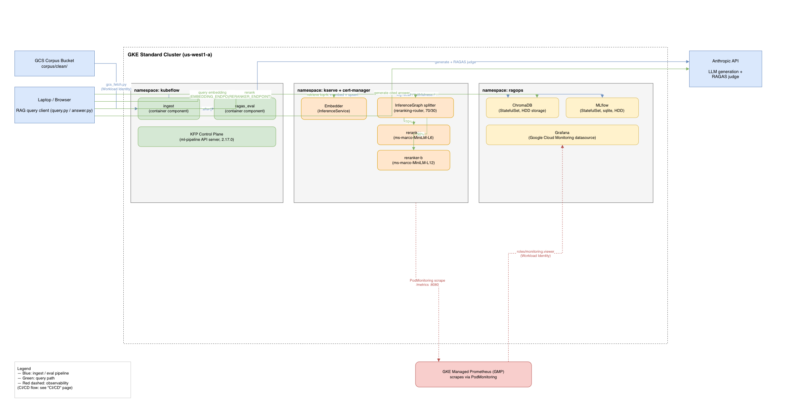
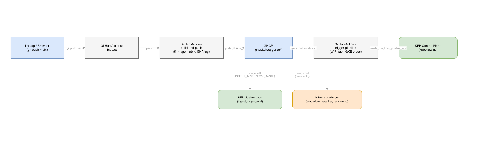

# RAGOps

A retrieval-augmented Q&A platform over a corpus of SEC 10-K filings —
ask a question about a company's filings, get back an answer cited by
ticker / fiscal year / filing item, not just a plausible-sounding guess.

The point of this project isn't the Q&A app itself — it's everything
around it: a pipeline that's used to systematically tune retrieval quality
instead of guessing at it, a real two-model canary rollout for the
reranker with live metrics instead of a simulated one, and CI/CD that
builds, tests, and runs the pipeline automatically on every push. The
source diagram is `diagrams/architecture.drawio` (open in
[diagrams.net](https://app.diagrams.net) — page 1 is runtime/observability,
page 2 is CI/CD); exported views are embedded below.

## Architecture at a glance


<!-- Export: open diagrams/architecture.drawio, page 1 "Runtime & Observability",
     File > Export as > PNG, save to diagrams/runtime-observability.png -->

Four pieces, tied together by CI/CD:

1. **Ingestion & evaluation pipeline** (Kubeflow Pipelines) — chunks and
   embeds the corpus into Chroma, then runs an offline RAGAS evaluation
   against it. This is the harness that was used to find the retrieval
   config actually in use today, and it reruns on every CI push so that
   number stays verified rather than tuned once and forgotten.
2. **Query/answer flow** — retrieve → rerank → generate, with every answer
   traceable back to the chunks it came from.
3. **Model serving & observability** — the embedding model and reranker
   run as their own services (KServe), with the reranker specifically
   deployed as a genuine two-checkpoint canary, visible live in Grafana.
4. **CI/CD** — GitHub Actions: lint/test → build & push five Docker
   images → trigger a pipeline run, authenticated to GCP via Workload
   Identity Federation (no stored credentials anywhere in the repo).

## Ingestion & evaluation pipeline

**Why it exists:** retrieval quality isn't something you can eyeball —
`top_k`, the per-document diversity cap, chunk size, and reranking all
trade off against each other, and the only way to know which combination
actually works is to run the same question set through each one and
measure it. That measurement loop is this pipeline.

**How it runs.** Two KFP container components, chained with `.after()`:
- `ingest` — pulls `corpus/clean/` from a GCS bucket (`ingestion/gcs_fetch.py`,
  authenticated via Workload Identity — no service account key), then runs
  the existing `ingestion/` code (load → chunk → embed → upsert) against
  an in-cluster Chroma.
- `ragas_eval` — runs the eval set through the current retrieval config
  (`evaluation/generate.py`), scores it with RAGAS judges
  (`evaluation/ragas_eval.py`), and logs params + `recall` /
  `faithfulness` / `answer_relevancy` / `context_precision` to an
  in-cluster MLflow run.

**What it found.** A 6-variant sweep across `top_k` and per-doc cap
settings picked `wide+capped` (`top_k=12`, `per_doc_cap=3`) as champion —
registered in MLflow as `rag-query-path` v1 `@champion` — on `mean_recall`,
since `faithfulness` and `context_precision` were noise-dominated at this
eval-set size (see Reproducibility check below for the actual spread).
That config is what `rag/` uses today. The reranker (below) exists to
specifically target `context_precision`, the weakest of the four metrics:
recall is high (0.88) but precision is low, meaning retrieval finds the
right filings but returns a lot of irrelevant chunks alongside them —
reranking is meant to push the relevant ones to the top before the
per-doc cap and the LLM ever see them.

## Query / answer flow

`rag/query.py` is the entry point. For a question:

1. **Retrieve** (`rag/retriever.py`) — top-k chunks from Chroma, embedded
   either locally or via the in-cluster Embedder service
   (`EMBEDDING_ENDPOINT`, falls back to local if unset).
2. **Rerank** (`rag/reranker.py`) — if `RERANKER_ENDPOINT` is set, the
   candidates are sent to the KServe reranker canary and reordered by
   relevance before anything else touches them.
3. **Cap** — a per-document diversity cap (`cap_per_doc`) keeps any one
   filing from dominating the context window, applied *after* reranking
   so it works from the more accurate ordering.
4. **Generate** (`rag/generator.py` via `rag/answer.py`) — the LLM answers
   from the capped context, citing ticker / fiscal year / item using
   metadata stored per chunk at ingestion time.

Every stage can run fully local (for fast iteration) or call out to the
in-cluster services — same code path either way, just an endpoint env var.

## Model serving & observability

**Embedder** (`serving/embedder/`) — a custom KServe predictor wrapping
`ingestion.embedder.embed_texts`, so query-time embedding uses the exact
same model ingestion used to build the index.

**Reranker canary** (`serving/reranker/`) — a custom KServe predictor
wrapping `sentence_transformers.CrossEncoder`, deployed *twice*
(`reranker` on `cross-encoder/ms-marco-MiniLM-L6-v2`, `reranker-b` on the
larger `-L12-v2`) behind a KServe `InferenceGraph` splitting traffic
70/30. Both checkpoints are baked into one shared image; which one a pod
loads is picked at runtime via `MODEL_CHECKPOINT`. This was verified with
real, differing scores for identical input — a genuine two-model canary,
not two copies of the same model proving the plumbing works.

**Observability** — Grafana + GKE Managed Prometheus (GMP), in-cluster,
using Grafana's native Google Cloud Monitoring data source authenticated
via Workload Identity (`roles/monitoring.viewer`) rather than the more
complex `datasource-syncer` CronJob path. A `PodMonitoring` resource
(`k8s/kserve/podmonitoring.yaml`) scrapes all KServe predictors' `/metrics`
endpoints, since GMP doesn't auto-discover scrape targets. Two dashboards
(`dashboards/`) show request rate and p95 latency; the reranker dashboard
is the more interesting one — it plots both checkpoints side by side and
visibly shows their different latency profiles under the live canary
split.

## CI/CD


<!-- Export: open diagrams/architecture.drawio, page 2 "CI/CD",
     File > Export as > PNG, save to diagrams/cicd.png -->

`.github/workflows/ci.yml`, three jobs on every push to `main`:

1. **lint-test** — Ruff + pytest.
2. **build-and-push** — matrix build of five images (`rag-api`,
   `ragops-ingestion`, `ragops-evaluation`, `ragops-embedder`,
   `ragops-reranker`), tagged by commit SHA, pushed to GHCR.
3. **trigger-pipeline** — authenticates to GCP via Workload Identity
   Federation (no stored GCP credentials — OIDC token exchange), fetches
   GKE credentials, port-forwards to the in-cluster KFP API, and submits
   a run of the ingestion/eval pipeline against that commit's images
   (`pipelines/trigger_run.py`).

## Infrastructure (`terraform/`)

A **GKE Standard, zonal** cluster (`us-west1-a`) — started on Autopilot,
migrated to Standard, because Autopilot's non-preemptible system balloon
pod plus the project's SSD quota left no room for cert-manager, KServe,
two model services, and a canary split at once. Node pool is two
`e2-standard-4` nodes with Workload Identity enabled. The corpus GCS
bucket lives in its own Terraform root (`terraform/storage/`) with
separate state, and now also holds the Workload Identity Federation
pool/provider/service-account binding GitHub Actions authenticates
through.

Bring the cluster up day-to-day via `make cluster-up` / `make
cluster-down` (see `DEV_START.md` for the full checklist). `cluster-down`
deletes every namespace owning a PersistentVolumeClaim before destroying
the cluster — deleting the cluster directly skips the Kubernetes API, so
the CSI driver never cleans up its disks and they orphan against the SSD
quota otherwise.

Two setup gotchas, in case they recur: (1) ADC user credentials don't
reliably pick up a quota project for billing APIs — fixed via
`user_project_override = true` + `billing_project` on the `google`
provider block; (2) a brand-new GCP project needs
`cloudresourcemanager.googleapis.com` enabled manually before Terraform
can manage any other API via `google_project_service`.

## Reproducibility check

The KFP pipeline (`ingest` then `ragas_eval`) ran against the champion
config (`wide+capped`: `top_k=12`, `per_doc_cap=3`) on **four separate
from-scratch cluster builds**, spanning 2026-09-26 to 2026-10-10 — the
cluster gets torn down and rebuilt most days (see Infrastructure above),
so each of these started from an empty Chroma index with the corpus
re-pulled from GCS and re-embedded from nothing.

`mean_recall` was **0.8819583333333334** on every single one of the four
runs — bit-for-bit identical. Recall is computed from retrieved-source
metadata only (no LLM judge), so an exact match across four independent
cluster builds means the corpus, chunking, embeddings, index and
retrieval config all reproduce end to end, not just once.

The LLM-judged metrics don't match exactly, as expected: across the same
four runs, `faithfulness` ranged 0.80–0.86, `answer_relevancy` 0.55–0.64,
`context_precision` 0.10–0.17, all at identical recall — judge and
generation noise on a small eval set, not a pipeline difference.
`context_precision` is the noisiest, and the one the reranker targets.

One intermediate attempt (2026-10-05) failed outright before producing
any metrics — `Anthropic API error 401: API key is invalid`, a stale
credential, not a pipeline bug — fixed and re-run successfully within the
hour. Worth logging here rather than quietly excluding it: the failures
are visible in MLflow's run history too, not just the successes.

## Repo layout

```
ingestion/      load -> chunk -> embed -> upsert (Chroma)
airflow/        Airflow DAG + docker-compose wrapping ingestion (superseded by the KFP pipeline)
rag/            retrieval -> rerank -> prompt -> generation -> cited answer
evaluation/     offline eval (generate + RAGAS judge), runs as a KFP component
serving/        custom KServe predictors (embedder, reranker)
pipelines/      KFP v2 SDK pipeline + component definitions
k8s/            kustomize overlays and manifests (KFP, Chroma, MLflow, KServe, Grafana)
diagrams/       system architecture diagram (draw.io, 2 pages: runtime, CI/CD)
dashboards/     exported Grafana dashboards (Embedder, Reranker)
terraform/      GKE Standard cluster + VPC + API enablement + budget alert
terraform/storage/  corpus GCS bucket + Workload Identity grants (separate state, survives teardown)
tests/          pytest suite (chunker, retriever, answer)
corpus/         pulled 10-K filings (gitignored)
Evaluation.md   eval question set and methodology
```

## Scope and known gaps

Called out explicitly rather than left to be discovered:

- **No deployed RAG API service.** The query/answer orchestration
  (`query.py` / `answer.py`) runs from wherever it's invoked (laptop,
  CI), calling into the in-cluster Chroma/Embedder/Reranker services and
  out to the Anthropic API — it's a client, not a standing in-cluster
  service. Every piece of infrastructure this project owns *is* served
  and observable; the orchestration layer deliberately isn't, since
  adding a deployed API gateway wasn't where the interesting MLOps
  problems were.
- **Dev → staging promotion was scoped out.** CI/CD builds, tests, and
  runs the pipeline automatically; a staged promotion flow with an
  approval gate was deliberately dropped in favor of finishing
  documentation and the demo.
- **Kafka → KFP trigger swap was tabled.** The Week 2 Kafka consumer
  still submits to the old Airflow DAG rather than the KFP API.
- **No error-rate panel.** KServe's default instrumentation here only
  exposes latency histograms, not an HTTP-status-labeled counter; adding
  one would have meant custom instrumentation.
